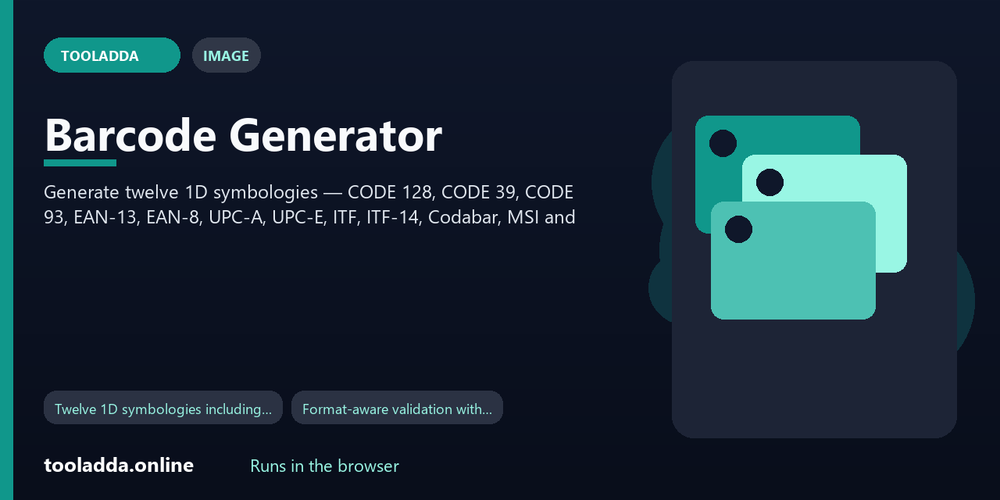
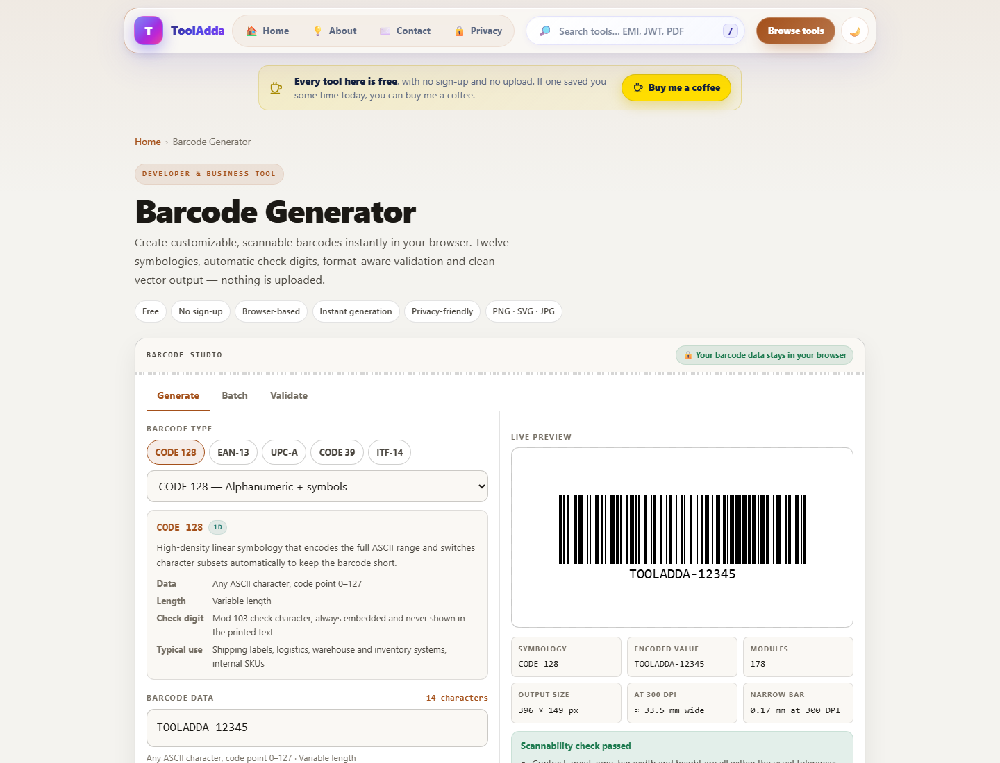
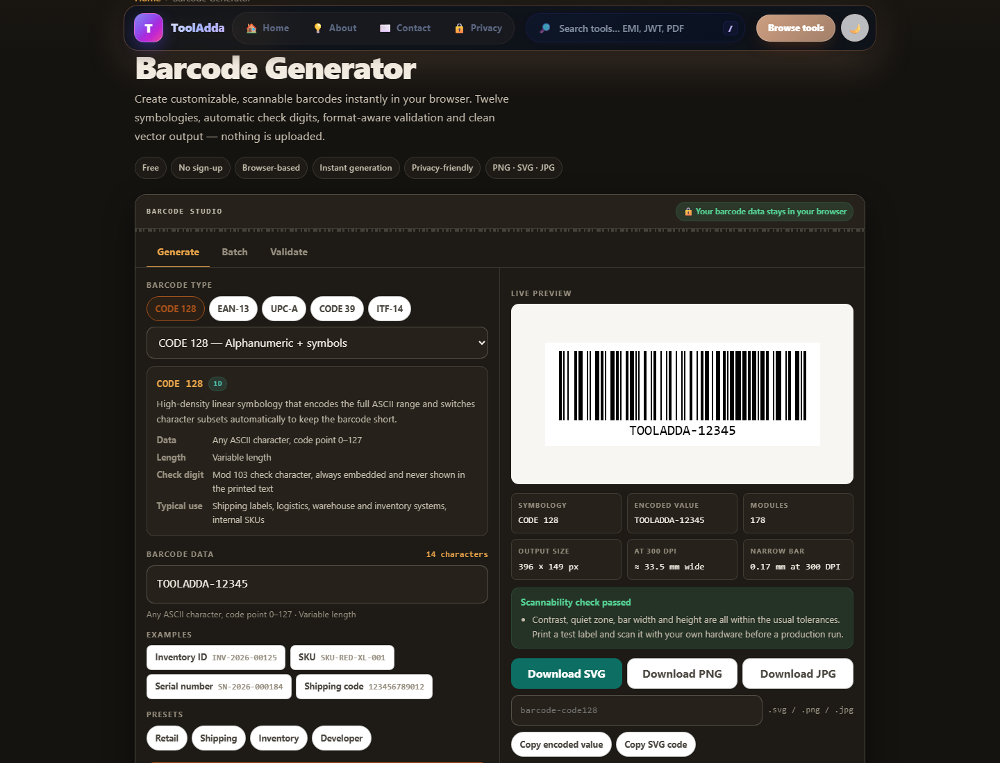
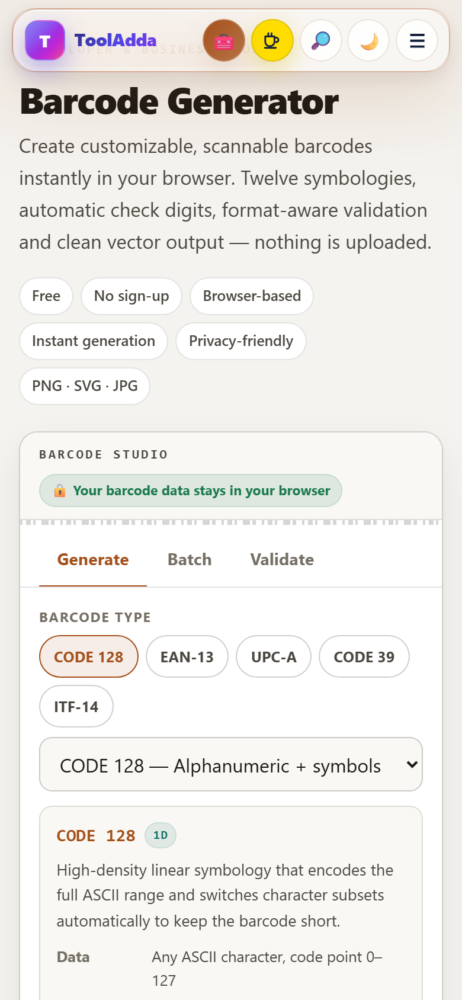

  

# Barcode Generator

**Generate twelve 1D symbologies**

  

  
  
  
  

  <a href="#features"><b>Features</b></a>
  &nbsp;·&nbsp;
  <a href="#how-to-use"><b>How to use</b></a>
  &nbsp;·&nbsp;
  <a href="#screenshots"><b>Screenshots</b></a>
  &nbsp;·&nbsp;
  <a href="#faq"><b>FAQ</b></a>

---

## What it does

Generate twelve 1D symbologies — CODE 128, CODE 39, CODE 93, EAN-13, EAN-8, UPC-A, UPC-E, ITF, ITF-14, Codabar, MSI and Pharmacode — with automatic check digits, a barcode validator, batch generation and PNG, SVG or JPG export.

## Features

- Twelve 1D symbologies including CODE 128, EAN-13, UPC-A and ITF-14
- Format-aware validation with specific, actionable error messages
- Automatic check digit calculation and verification
- Live preview that matches the downloaded file exactly
- Custom bar width, height, quiet zone, colours and human-readable text
- Rotation and bearer bars for ITF-14
- Scannability warnings for contrast, quiet zone and bar width
- Batch generation from a list or CSV with ZIP download

  <a href="https://tooladda.online/barcode-generator.html"><b>Use Barcode Generator on ToolAdda →</b></a>

## How to use

No account is required.

1. **Choose a symbology** — Pick the barcode format your scanner or standard requires — CODE 128 for general use, EAN-13 or UPC-A for retail, ITF-14 for shipping cartons.
2. **Enter your data** — Type the value you want to encode. The tool validates it against the character set and length rules of the selected format as you type.
3. **Let the check digit calculate** — For EAN, UPC and ITF-14, enter the payload without the final digit and the check digit is calculated for you, or paste the complete code and it is verified.
4. **Adjust size and appearance** — Set the bar width, height, quiet zone, colours and human-readable text. Scannability warnings appear if a setting would make the symbol hard to read.
5. **Download** — Download SVG for print and labels, or PNG at a print resolution preset for documents and screens.

## How it works

### CODE 128

The default, and the right answer for most people. Encodes the full ASCII set and packs digit pairs into single symbol characters, so it is the shortest general-purpose barcode for mixed data.

### Pharmacode

Pharmaceutical packaging control. It encodes a single integer from 3 to 131070 as a binary sequence of thin and thick bars, with no human-readable line at all.

Looking for a 2D code? QR is a different family entirely — use the QR Code Generator or the Custom QR Code Maker for URLs, Wi-Fi credentials and contact cards.

## Screenshots

Same page, three views. These are the live interface, not a mockup.

  
   
  <b>Desktop.</b> Generate twelve 1D symbologies.

  
  &nbsp;
  
   
  <b>Dark theme</b> and the <b>phone</b> layout.

  <a href="https://tooladda.online/barcode-generator.html"><b>Open Barcode Generator on ToolAdda →</b></a>

## Use cases

This fits photographers, designers, students preparing uploads, and people publishing pictures.
- Twelve 1D symbologies including CODE 128, EAN-13, UPC-A and ITF-14.
- Format-aware validation with specific, actionable error messages.
- Automatic check digit calculation and verification.
- Live preview that matches the downloaded file exactly.

## Privacy

The work happens in your browser. Text, files, and results are handled on your device and are not uploaded to a ToolAdda server. This page does not register a service worker, so it needs the site to be reachable when you open it. The site can also record a page view. That request does not include the text or file you are working on.

## Technology

`HTML5` · `CSS3` · `JavaScript` · `JsBarcode` · `JSZip` · `File API` · `Canvas API` · `localStorage`

## FAQ

<b>How do I create a barcode?</b>

 

Select the symbology your scanner or standard requires, type the value you want to encode, adjust the size if you have a specific label to fit, then download the result as SVG for print or PNG for screens and documents. The whole process takes under twenty seconds.

<b>Can I create a barcode for inventory?</b>

 

Yes, and CODE 128 is the right choice. Internal inventory codes need no registration, so you can use any scheme you like - a location prefix, a SKU, a serial number - as long as each value is unique within your system.

<b>Can I create printable barcodes?</b>

 

Yes. Download SVG for print: it is vector, so it stays sharp at any physical size and your label software can scale it without softening the bar edges.

<b>Can I download barcodes as PNG?</b>

 

Yes. PNG is lossless and keeps bar edges hard, which makes it the right raster format for barcodes.

<b>Can I download barcodes as SVG?</b>

 

Yes, and it is recommended for print and label design. The SVG contains one rectangle per bar plus a text element, so it opens cleanly in Illustrator, Inkscape, Figma and label software, and can be recoloured or resized with no quality loss.

<b>Can I generate barcodes in bulk?</b>

 

Yes. The Batch tab accepts one value per line or a CSV file, validates every row, shows which rows failed and why, and downloads all successful barcodes as a ZIP containing both PNG and SVG for each value.

<b>How much white space should be around a barcode?</b>

 

At least ten times the narrow bar width on each side for most symbologies, and eleven modules on the left of an EAN-13. It must be genuinely empty - no text, borders or graphics - because the scanner uses it to locate where the symbol starts and ends.

<b>Can barcodes contain letters?</b>

 

Some can. CODE 128 encodes the full ASCII set including lowercase and punctuation; CODE 39 and CODE 93 encode uppercase letters, digits and a handful of symbols.

## Related tools

| Tool | What it does |
|---|---|
| [Image Watermark](https://tooladda.online/image-watermark.html) | Adds a text or logo watermark to raster images — JPG, PNG, WebP, GIF, BMP and AVIF in, PNG, JPEG or WebP out. |
| [QR & Barcode Label Sheet Generator](https://tooladda.online/qr-barcode-label-sheet-generator.html) | Turns a list of values into a printable sheet of QR or barcode labels, entirely in the browser. |
| [Printable ID Card Maker](https://tooladda.online/cyber-tools/id-card-sheet-generator.html) | Builds identity cards and lays them out on a printable sheet, entirely in the browser. |
| [SVG to PNG / JPG / WebP](https://tooladda.online/svg-to-png-converter.html) | Rasterize SVG files to PNG, JPG or WebP with custom dimensions, aspect-ratio lock, transparent or solid… |
| [Custom QR Code Maker](https://tooladda.online/custom-qr-code-maker.html) | The styling counterpart to the main generator — the trade-off is deliberate, so state it clearly: this one… |

## Learn more

Formats named around Barcode Generator include PNG, SVG, JPG, CSV. The live Barcode Generator page keeps the longer guide, the edge cases, and the rest of the questions. This repository summarizes the behavior that is implemented so you can decide whether the page fits the job.

## License

This repository showcases [Barcode Generator](https://tooladda.online/barcode-generator.html). It does not contain the tool's source code, and no open-source license is granted.

---

  Made for people who want the result in a browser tab. 
  <a href="https://tooladda.online/"><b>ToolAdda</b></a> — free online utilities for developers, students, creators and everyday work.

